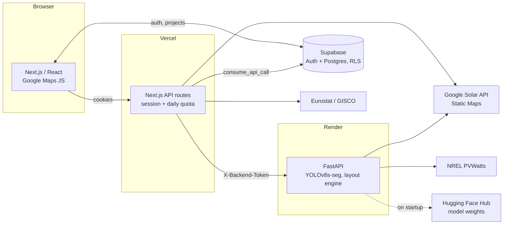

# FinestCloud

[](https://github.com/borc23/FinestCloud/actions/workflows/ci.yml)

**Rooftop solar design in the browser.** A fine-tuned YOLOv8 model finds each roof plane in satellite imagery, a deterministic layout engine fills the planes with panels, and Google Solar API and NREL PVWatts data turn the layout into a production, financing and wiring plan for an installer.

<!-- TODO: replace with your production URL (see docs/DEPLOYMENT.md#live-demo-link) -->
**Live demo:** https://finest-cloud.vercel.app (click **Try the demo**, no sign-up needed)

<!-- TODO: record a 20-30 s GIF (search address → detect roofs → generate panels → open the report),
     save it as docs/images/demo.gif and uncomment:

-->

## What it does

1. **Find the building:** search an address on a Google satellite map.
2. **Detect roofs:** one click captures the view. The backend fetches the tile and segments every roof plane into an editable polygon.
3. **Adjust:** drag corners, draw missing planes, and mark chimneys or skylights as obstacles.
4. **Place panels:** each plane gets its own grid, using its pitch and azimuth (from the Google Solar API, adjustable), edge setbacks, spacing, and the best panel orientation.
5. **Analyse:**
   - monthly production (NREL PVWatts) and a sunshine heat map (Solar API annual flux GeoTIFF, decoded in the browser)
   - payback with the local household electricity price (Eurostat)
   - cash vs. loan financing
   - inverter and string sizing
6. **Deliver:** export a branded PDF report and save the project. Teams share projects inside an organization, with roles, invitations and their own logo and colours.

## Engineering highlights

| | |
|---|---|
| **Roof plane segmentation** | YOLOv8s-seg fine-tuned on top-down tiles, one class per planar roof face. Validation mask **mAP50-95 0.921**, ~0.5 s per tile on CPU. Masks become clean polygons via Douglas–Peucker on the closed contour. [Model card →](docs/MODEL.md) |
| **Layout engine** | Replaced a 581-line genetic algorithm with a 96-line deterministic, vectorized grid search (Shapely 2 + STRtree). It's **7–23× faster** (13.4 s → 0.8 s on a 40 × 25 m roof), gives the same layout every time, and matches or beats the GA's panel count on 3 of 4 test roofs. [Benchmarks →](docs/BENCHMARKS.md) |
| **Paid-API protection** | Every API route checks the Supabase session and spends a per-user daily quota, counted atomically in Postgres so serverless instances share it. The backend accepts only the Next.js server (shared secret, constant-time compare). Server-side API keys never reach the browser. |
| **Multi-tenancy** | Postgres row-level security on every table. Role and membership changes happen only through `SECURITY DEFINER` functions that enforce the rules server-side. |
| **SSRF-safe proxies** | The backend builds the Static Maps URL itself from validated map parameters, and the GeoTIFF proxy only forwards to `solar.googleapis.com`. Both have tests. |
| **Tested in CI** | Ruff + pytest, ESLint + tsc + Jest + production build, and the full migration chain replayed on a fresh Postgres with SQL tests for the quota rules. |

## Architecture



| Layer | Stack |
|---|---|
| Frontend | Next.js 14 (App Router), React 18, TypeScript, Google Maps JS API, geotiff.js + proj4, jsPDF |
| Backend | Python 3.10, FastAPI, Ultralytics YOLOv8, PyTorch (CPU), OpenCV, Shapely 2, httpx |
| Data | Supabase (Postgres, Auth, Storage), row-level security, SQL migrations |
| Ops | Docker, Render, Vercel, GitHub Actions, uv, pre-commit (ruff, ESLint, Prettier) |

```
src/finestcloud/        FastAPI app: routes, detection, panel layout, PVWatts
tests/                  pytest (external APIs mocked)
frontend/app/           Next.js pages and API routes
frontend/features/      feature modules: map drawing, solar analysis, panels, financial, electrical, reports, organizations
frontend/supabase/      migrations (timestamped) and SQL tests
scripts/                benchmark and model report
docs/                   model card, benchmarks, deployment
```

## Running locally

Prerequisites: [uv](https://docs.astral.sh/uv/), Node 22, a Supabase project, and API keys for Google Cloud (Maps JavaScript, Static Maps, Solar API) and [NREL](https://developer.nlr.gov/signup/).

```bash
# Backend: http://127.0.0.1:8000 (API docs at /api/docs)
cp .env.example .env                          # fill in keys and a BACKEND_API_TOKEN
uv sync
uv run pre-commit install
uv run finestcloud

# Frontend: http://localhost:3000
cd frontend
cp .env.example .env.local                    # same BACKEND_API_TOKEN as the backend
npm install
npm run dev
```

Apply the files in `frontend/supabase/migrations/` to your Supabase project in order (SQL editor, or `supabase db push` from `frontend/`). The YOLO weights download from Hugging Face on first start.

## Tests

```bash
uv run pytest                          # backend
cd frontend && npm test                # frontend (Jest)
cd frontend && npm run lint && npx tsc --noEmit
```

The CI `database` job replays every migration on a fresh Postgres and runs `frontend/supabase/tests/*_test.sql`; see [`.github/workflows/ci.yml`](.github/workflows/ci.yml) to run it locally.

## Docs

- [Model card](docs/MODEL.md): training setup, metrics, limitations
- [Benchmarks](docs/BENCHMARKS.md): layout engine vs. genetic algorithm, detection latency
- [Deployment](docs/DEPLOYMENT.md): environment, API protection, live demo setup

---

Built by Bor Černe. <!-- TODO: add LinkedIn / portfolio link -->
