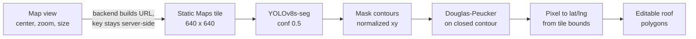
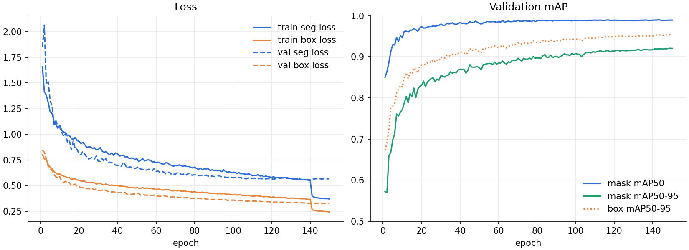

# Roof plane segmentation model

FinestCloud finds roofs by running an instance segmentation model on the satellite tile of the area the user is looking at. Each detected **roof plane** becomes an editable polygon on the map, and the panel layout and production estimate are then computed per plane.

| | |
|---|---|
| Weights | `v3.pt` on Hugging Face Hub: [`Borc23/finestcloud-models`](https://huggingface.co/Borc23/finestcloud-models) |
| Architecture | YOLOv8s-seg (11.8 M parameters), fine-tuned from COCO weights |
| Task | Instance segmentation, 1 class: `slope` (one planar roof face) |
| Input | 640 × 640 RGB satellite tile (Google Static Maps) |
| Output | One polygon per roof plane, in lat/lng |
| Validation mask mAP50-95 | **0.921** (mAP50 0.989) |
| CPU inference | ~0.45 s per tile, see [benchmarks](BENCHMARKS.md) |

## Why segment roof planes rather than roofs

A gable roof is two surfaces facing opposite directions, and a hip roof is four. Panel output depends on each surface's tilt and azimuth, and panels can't straddle a ridge. So the model predicts every planar face separately (class `slope`). The app then looks up pitch and azimuth for each plane from the Google Solar API and fills each plane with its own panel grid.

## Pipeline



- **Contour simplification** (`detection_service._simplify`): masks come out as dense contours with hundreds of points. Running OpenCV's `approxPolyDP(closed=True)` on them picks an arbitrary start point and can drift. Instead, the contour is split at the point farthest from its start, and each half is simplified as an open polyline (the same thing the `rdp` package does). That turns a noisy mask into 4 to 8 clean corners a user can drag.
- **Georeferencing** (`_to_geo`): Ultralytics letterboxes the input itself and reports mask points normalized to the original image. So the points map straight onto the tile's north/south/east/west bounds without undoing the padding.
- **Concurrency**: FastAPI runs sync routes in a thread pool, but a YOLO predictor isn't thread-safe. One model is loaded at startup and calls into it are serialized with a lock.

## Training

Fine-tuned with Ultralytics 8.3.29 on one GPU. The run finished on 2024-12-31 after 150 epochs (1.6 h).

| Setting | Value |
|---|---|
| Base weights | `yolov8s-seg.pt` (COCO) |
| Image size / batch | 640 / 16 |
| Epochs / early-stop patience | 150 / 60 |
| Optimizer / LR | AdamW (picked by Ultralytics' `auto`), lr 0.002 decaying linearly to 1%, 3 warm-up epochs |
| Augmentation | mosaic 1.0 (off for the last 10 epochs), horizontal flip 0.5, rotation ±0.15°, scale ±0.2, HSV jitter |
| Reproducibility | seed 0, deterministic mode, mixed precision |

Vertical flips are off and rotation is almost zero on purpose. Tiles are always north-up from the same top-down view, so heavy geometric augmentation would teach the model views it never sees.

### Dataset

> privately obtained data and hand labelled and verified.
> This demo has not production model as it is in prod therefore result is not optimal.

### Results

Metrics on the validation split at the end of training (from the checkpoint's own training log; regenerate with `scripts/model_report.py`):

| Metric | Box | Mask |
|---|---:|---:|
| Precision | 0.983 | 0.984 |
| Recall | 0.972 | 0.972 |
| mAP50 | 0.990 | 0.989 |
| mAP50-95 | 0.954 | **0.921** |



How to read this:

- **mAP50-95 for masks is the number that matters.** Panels are placed inside the polygon with a 30 cm edge margin, so boundary accuracy counts, not just "found the roof". 0.921 means the masks stay accurate even at strict overlap thresholds.
- **The drop at epoch 140** is mosaic augmentation switching off (`close_mosaic=10`). Training images suddenly look like the validation images, so training loss falls; validation loss doesn't move.
- **Validation loss flattens from about epoch 110** while training loss keeps falling. mAP still creeps up, so the final weights are the best ones, but more epochs wouldn't help.
- **Caveat:** these are validation-split numbers from the same data distribution as training, not a held-out test set from new areas. Real-world accuracy on unseen regions, roof styles and image dates is likely lower. The app is built around that: detection only proposes polygons, and the user can edit or redraw them before any panels are placed.

## How the model evolved

1. **Dec 2024, prototype:** a roof segmentation model on street-level photos (class `roof`). That showed segmentation worked, but the side-on view has no usable geometry for panel layout.
2. **Dec 2024, v3 (deployed):** top-down satellite tiles, labeled per roof plane (`slope`), so polygons map 1:1 onto real surfaces with their own tilt and azimuth.
3. **Experiment:** a variant trained on Sobel edge-filtered tiles (`v3_sobel.pt`) was not adopted. **TODO (author):** add why (for example, how its mAP compared).

## Known limitations

- **Occlusion:** trees overhanging the eaves cut into masks. Plane boundaries under heavy shadow are less precise.
- **Small features:** dormers, chimneys and skylights may merge into the surrounding plane. Users mark them as obstacles, and the layout keeps panels clear of them.
- **Flat roofs** with dense equipment can split into several fragments.
- **Imagery:** quality depends on Google's tile resolution and capture date for the location.

## Reproducing the numbers

```bash
uv run python scripts/model_report.py /tmp/models/v3.pt   # tables above + docs/images/training_curves.png
uv run python scripts/benchmark.py --only detection       # CPU latency
```

The app downloads the weights to `MODELS_DIR` (default `/tmp/models`) on first start, see `src/finestcloud/utils/model_loader.py`.

> If you also publish this as the Hugging Face model card (the repo's `README.md`), the same text works there. Ultralytics is AGPL-3.0, which applies to the weights and to services built on them.
